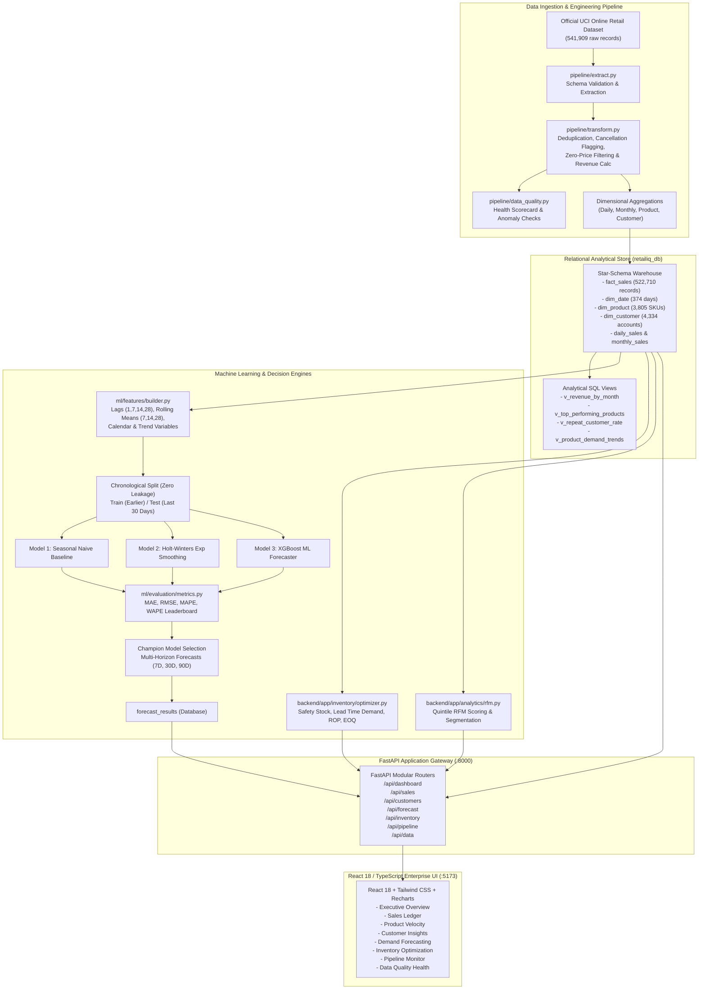
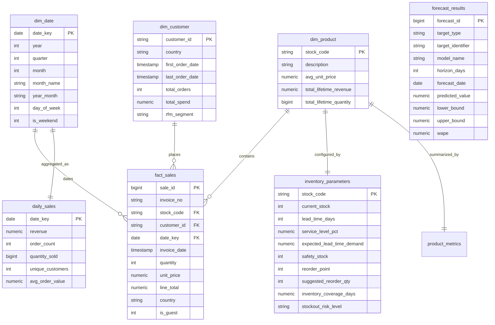
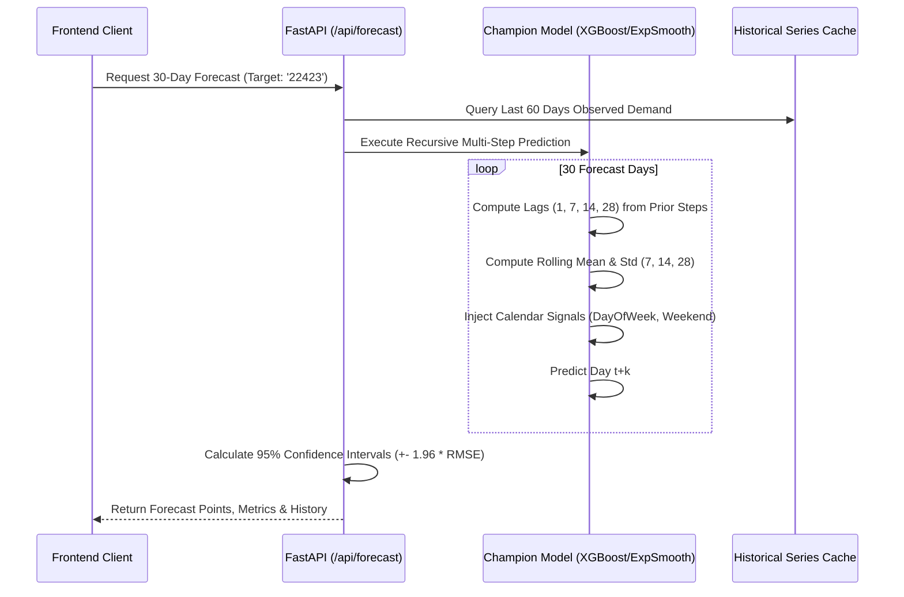
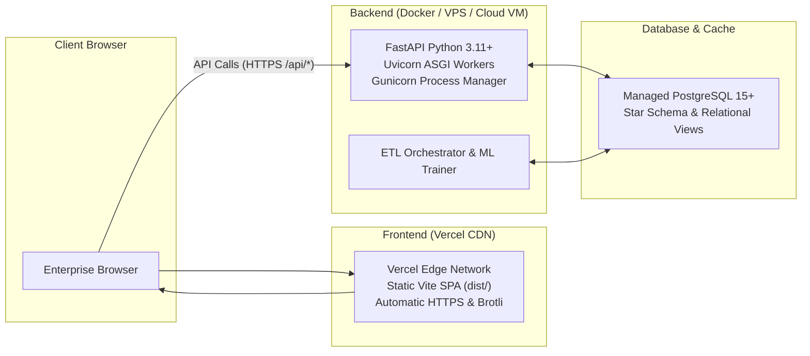

# RetailIQ: System Architecture & Technical Topology

RetailIQ is an end-to-end Enterprise Retail Intelligence and Demand Forecasting Platform. This document outlines the end-to-end data engineering, machine learning, API, and frontend architectures.

---

## 1. End-to-End System Architecture



---

## 2. Database Entity Relationship Diagram (ERD)



---

## 3. Time-Series Feature Engineering Architecture

To guarantee strict zero-data leakage, the feature generation pipeline employs the following architecture:

```
[Raw Historical Timeline]
        │
        ▼
[Continuous Reindexing (fills zero-sales closed days with 0.0)]
        │
        ▼
[Shift Target by 1 (y_t-1)]
  ├── Lags: Lag 1, Lag 7, Lag 14, Lag 28
  ├── Rolling Windows: Mean 7, Mean 14, Mean 28, Std 7, Std 14, Std 28
  └── Calendar Signals: Day of Week, Month, Week of Year, Weekend Flag, Trend Index
        │
        ▼
[Chronological Train / Test Split]
  ├── Train: First N - 30 days
  └── Out-of-Time Test: Last 30 days
```

---

## 4. Multi-Horizon Recursive Forecasting Engine



---

## 5. Deployment Topology


